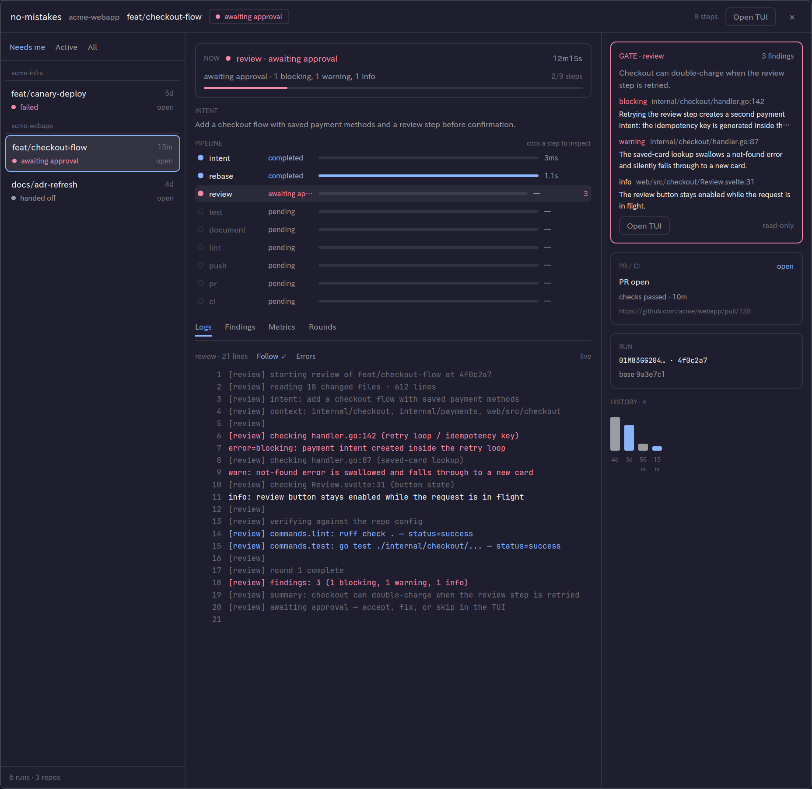

# herdr-app-plugins

[CNife](https://github.com/CNife) 的 [Herdr](https://herdr.dev) mod 集合。每个子文件夹是一个 mod，按 Herdr 的分享约定组织：

```
<mod>/
├── mods/<mod>/     # 安装到 ~/.config/herdr-app/mods/<mod>/
├── RECIPE.md       # 从空文件夹重建它的说明（给 agent 的 brief）
└── preview.png
```

| Mod | 说明 |
| --- | --- |
| [no-mistakes](no-mistakes/) | no-mistakes 流水线的只读驾驶舱：运行列表、步骤时间线、实时日志、findings、token 与时长指标。 |

## no-mistakes



在 Herdr 里用浮窗盯住 [no-mistakes](https://github.com/kunchenguid/no-mistakes) 的流水线：左侧是 run 列表（按仓库分组，可按 Needs me / Active / All 过滤），中间是当前步骤、意图、流水线时间线和 Logs / Findings / Metrics / Rounds 四个标签页，右侧是 gate 的 findings、PR/CI 状态、run 事实和历史耗时柱状图。宽度在 980px 及以上时显示右侧栏，窄了就只留主区。

它是只读的：只用 `sqlite3 -readonly` 读 `~/.no-mistakes/state.sqlite` 和 `~/.no-mistakes/logs/`，不写数据库、不迁移。会改变外部状态的只有两处——点 “Open TUI” 时打开 `no-mistakes attach --run <id>`，点 PR 链接时调用系统浏览器。

### 依赖

- 装了本 mod 的机器上：
  - [Herdr](https://herdr.dev)（带 mod 支持）
  - [no-mistakes](https://github.com/kunchenguid/no-mistakes) CLI，数据由它写入；本 mod 测试于 v1.111.0
  - `sqlite3` 命令行（需要 `-readonly` 与 `-json`，3.33+）
  - 可选：`git`（把 run 解析到分支的 checkout）与 PATH 里的 `no-mistakes`（“Open TUI” 按钮）
- 看远端机器的数据时，远端也要有 `sqlite3` 和 `~/.no-mistakes/state.sqlite`。

### 安装

注意：这是 **herdr-app**（桌面应用）的 mod，不是 `herdr`（TUI）的 workflow plugin——`herdr plugin install` 不适用。两者目录和格式不同：app mod 是 `~/.config/herdr-app/mods/<name>/` 下的 `mod.json` + JS，TUI plugin 是 `~/.config/herdr/plugins/` 下的 `herdr-plugin.toml`。

官方没有安装命令：herdr.dev/mods 的方式是把一行提示词交给你的 agent，由它读 `~/.config/herdr-app/AGENTS.md`、逐个读这个 mod 的文件后再装。仓库被 gallery 收录后，把这一行交给 agent：

```text
Read ~/.config/herdr-app/AGENTS.md, then add this mod: herdr.dev/mods/CNife/herdr-app-plugins--no-mistakes
```

收录前（或不想等）把地址换成 GitHub 仓库，同样交给 agent：

```text
Read ~/.config/herdr-app/AGENTS.md, then add the no-mistakes mod from https://github.com/CNife/herdr-app-plugins
```

下面的脚本把同一套动作（复制到 `mods/`、跑 check、不动 `keys.json`）本地化，适合你自己的机器、批量安装或没有 agent 的场合；它不读代码，只复制，所以装别人的 mod 时优先用上面的 agent 方式。

```sh
git clone https://github.com/CNife/herdr-app-plugins.git
cd herdr-app-plugins
./install.sh
```

脚本把每个 `<mod>/mods/<name>/` 复制（rsync）到 `${HERDR_APP_HOME:-~/.config/herdr-app}/mods/<name>/`，排除 Herdr 自己生成的 `gpui-kit.d.ts`、`jsconfig.json` 和 `*.error`，装完逐个跑 `herdr-app check`。它不会动 `keys.json`；同名目录如果不是本脚本装的（没有 `.herdr-plugins-install` 标记）且内容与仓库不同，会先停下，确认后可用 `FORCE=1 ./install.sh` 覆盖。安装目录归仓库所有——改插件请改仓库，不要直接改 `~/.config/herdr-app/mods/no-mistakes/`。Herdr 在运行中会热加载，不用重启。

更新：`git pull` 后重新运行 `./install.sh`；如果提示同名目录已存在且不一致，按上面的 `FORCE=1` 处理。

手动安装（等价于 agent 的复制步骤）：

```sh
cp -R no-mistakes/mods/no-mistakes ~/.config/herdr-app/mods/
```

### 打开

浮窗（推荐）：

```sh
herdr-app do mod.open --name no-mistakes
```

再执行一次 `mod.open` 或点窗口右上角的 × 关闭。想用按键的话，把 [`no-mistakes/keys.json`](no-mistakes/keys.json) 里的绑定合并进 `~/.config/herdr-app/keys.json`（建议的 `ctrl-shift-m` 被占用了就换一个）：

```json
{
  "global": { "ctrl-shift-m": "mod.open:no-mistakes" },
  "terminal": { "ctrl-shift-m": "mod.open:no-mistakes" }
}
```

也可以把它当普通 tab 打开（窄屏或想和终端并排时）：

```sh
herdr-app do tab.new --name no-mistakes --mod no-mistakes
```

### 看远端机器

pane 的 props 里传机器名即可，例如在 layout 里：

```json
{ "mod": "no-mistakes", "props": { "machine": "vps" } }
```

命令行：

```sh
herdr-app do tab.new --name no-mistakes --mod no-mistakes --props '{"machine":"vps"}'
```

没有 `props.machine` 时读本机；`mod.open` 开的浮窗总是读本机。

### 兼容性与已知限制

- no-mistakes 的 SQLite schema 是它的内部实现，升级可能改列名；面板会显示错误横幅，而不是静默给出错的数据。测试于 no-mistakes v1.111.0。
- 没有数据时显示 “No runs found”，不影响打开。
- 远端机器取 home 依赖 `sh -c 'printf %s "$HOME"'`（Unix）；Windows 远端未验证。
- 本 mod 与 no-mistakes 项目无隶属关系。

## 开发

- 改插件请改本仓库里的 `no-mistakes/mods/no-mistakes/`，然后 `./install.sh`；Herdr 会热加载安装副本。
- 单个 mod 的检查：`herdr-app check no-mistakes/mods/no-mistakes`。
- `RECIPE.md` 是给 agent 从空文件夹重建这个 mod 的 brief；改了行为记得同步。

## License

MIT。图标来自 [Lucide](https://lucide.dev) 的 `shield-check`（ISC）。
