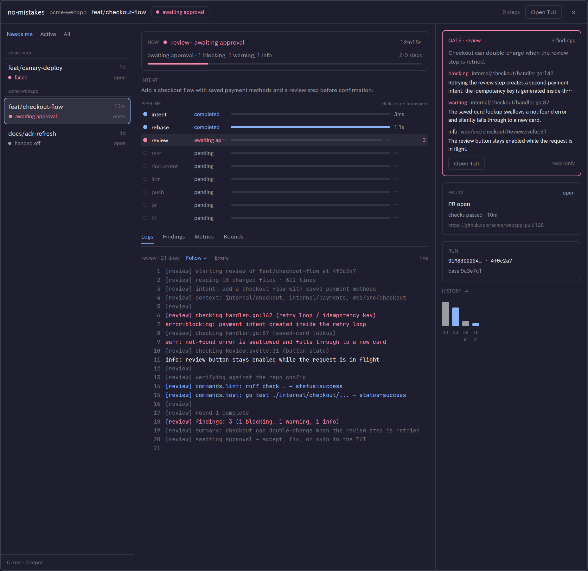

# no-mistakes Cockpit

A read-only cockpit for [no-mistakes](https://github.com/kunchenguid/no-mistakes) pipelines: a floating Herdr window that lists every run by repo, follows the current step's log, shows the review gate's findings, token and duration metrics, fix rounds, PR/CI state and the repo's run history. It reads the state database with `sqlite3 -readonly`; nothing in it writes to the database, and nothing leaves the machine.

## What you see

- **The window:** 1160px wide and 86% of the window's height, in Herdr's window frame. `mod.open` (or a key bound to `mod.open:no-mistakes`) opens it; the same command again closes it, as does the × at the window's top right. The text is 13px, in your theme's colors throughout.
- **Top bar**, 46px, bottom border: **no-mistakes** semibold (then ` · <machine>` when the pane props name another machine), the run's repo (11px `muted`), its branch (12px, cut at 360px), a status chip (22px, `surface`, 1px `border`, radius 5, a 6px dot and 10px text), a spacer, `9 steps` (10px `dim`), **Open TUI** (26px, 11px) while the run is running or pending, and the × (26px) when it is a floating window.
- **Run rail**, 264px, right border: a 40px filter row — **Needs me**, **Active**, **All** (11px; `accent` for the chosen one) — then a scrolling list grouped by repo: a 22px repo header (9px `dim`) and one row per run (branch 12px, age 10px, a 6px status dot and its word 10px, the PR state 10px `dim`). The selected row is `selected` with an `accent` border. A 32px footer says `N runs · M repos`.
- **Center**, 14px padding, 11px between blocks:
  - **NOW card** (`surface`, 1px `border`, radius 8, 11px padding): the word NOW (9px `dim`), a 7px dot that pulses while a step runs or fixes (`.loop` opacity), `<step> · <status>` (12px in the status color), the elapsed time (11px `muted`), the step's last activity line (11px `muted`, truncated), `2/9 steps` (10px `dim`), and a 3px progress bar.
  - **INTENT**: label 9px `dim`, the run's intent 11px `muted`; past 220 characters a **more** / **less** link (10px `accent`).
  - **PIPELINE**: label 9px `dim` and "click a step to inspect" (9px `dim`); one 24px row per step: an 8px dot (pending: an outlined 8px circle), the step name (11px, 76px), its status (10px in the status color, 64px), a 4px duration bar scaled to the longest step, the duration (10px, 64px), the findings count (10px `blocked`), and `exit N` when a step exited non-zero (`ansi1`).
  - **Tabs**, 34px: Logs, Findings, Metrics, Rounds (11px; the chosen one `accent` with a 2px underline).
  - **Logs**: a 22px header with `<step> · N lines`, **Follow** (`accent` when on), **Errors** (`ansi1` when on), and `live` / `paused` (10px `dim`); then the step's log tail (500 lines) in your settings' `font_family` (JetBrains Mono when unset), 11px, line numbers 34px `dim`. Lines are colored: red (`ansi1`) for `panic`, `fatal`, `FAIL`, `error=`, `exited … error`; `blocked` for `retry`, `warn`, `quiet`; `done` for `pi started`, `status=success`, `exited … success`; `dim` for lines that start with `[` or `{`.
  - **Findings**: the step's summary (11px `muted`) and one card per finding (1px `border`, radius 6, 10px padding): severity (10px colored: `ansi1` blocking/error, `blocked` warning/ask-user, `working` info), `file:line`, the action, the description (11px), and the instructions (10px `dim`).
  - **Metrics**: a 320×8 token bar (cache `ansi5`, input `ansi6`, output `ansi3`) with a legend; then one 22px row per agent invocation: step (90px), round (34px), `agent · model`, duration (64px), tokens (64px), tool calls (44px), exit status (60px, `done` when `ok`, `ansi1` otherwise).
  - **Rounds**: one card per fix round: `<step> · round N`, the trigger, the duration, the fix summary, and `N findings · selection`.
- **Right rail**, 300px, shown when the window is at least 980px wide, 12px padding and gaps:
  - **GATE card** (1px `blocked` border, radius 8): the gated step, the summary, the first three findings (severity, `file:line`, description), **Open TUI** while the run is active, and the word `read-only`.
  - **PR / CI**: the PR state, `checks passed · 10m` or `CI —`, and the URL (9px `dim`, opens the browser).
  - **RUN**: the run id and head/base shas, `waiting …`, parked time, and the worktree folder.
  - **HISTORY**: the repo's last 12 runs as 14px bars (48px tall at most), the selected one in `accent`, a waiting one in `blocked`, then their ages (8px `dim`).

## How it behaves

- **Refresh:** runs every 5s, the selected run's steps/invocations/rounds every 2s, and its log every 1.2s while the Logs tab is open and the step is running or fixing. A hidden or background copy keeps its timers; they are gentle.
- **Choosing a run:** click a row; the selection picks the waiting run first, else a handed-off one, else a running/pending one, else the newest. It is kept while it exists, and the rail scrolls the selected row into view.
- **Choosing a step:** click a pipeline row. With no choice it picks a waiting step, then a failed one, then a running/fixing one, then the last step with a log, then the last step. The Logs tab follows the step that has a log; steps that have not started or were skipped have none.
- **Logs:** Follow keeps the view at the newest line; Errors filters to lines that look like failures; the counter shows the whole file's line count while the tail is 500.
- **Status colors:** running/fixing `working`; awaiting approval/fix review `blocked`; completed/checks passed/passed `done`; failed `ansi1`; anything else `muted`. The chip says "awaiting approval" whenever a step waits for review, even if the run itself says running.
- **Open TUI** starts `no-mistakes attach --run <id>` in a new tab named no-mistakes, in the branch's own checkout when `git worktree list` can find it (the repo itself or a linked worktree), and in that checkout's existing space when one matches. It focuses the new tab.
- **PR links** open with `open` on macOS, `cmd /c start` on Windows, and `xdg-open` elsewhere.
- **The ×** closes the floating window (`closeOverlay(props().overlay)`). In a tab pane there is no ×; the tab closes it.

## Built from

- `mod.json`: `place: none`, `focusable`, `overlay: { kind: window, key: no-mistakes, width: 1160, height: 0.86 }`. That overlay is what `mod.open` shows; the mod also works as a tab pane (`tab.new { mod: "no-mistakes" }`) and as a layout block (`{ "mod": "no-mistakes", "props": { "machine": "vps" } }`).
- `main.js` (the `NoMistakes` view) and `model.js` (queries, picking, formatting). No layout files: the mod fills whatever pane or window hosts it.
- Live data from `herdr`: `props()` (the pane's `machine`, and the overlay id), `theme()`, `settings()`, `spaces()`, `checking()`, `window()`. Actions: `run("tab.new", …)`, `closeOverlay()`, `exec()`, `readTextFile()`.
- Data: `sqlite3 -readonly -json ~/.no-mistakes/state.sqlite` over `runs`, `repos`, `step_results`, `agent_invocations`, `step_rounds`. Runs are ordered newest first and capped at 80. Run ids are validated against `26` characters of `[0-9A-Z]`.
- Logs: the step's `log_path` once the step ended; otherwise `~/.no-mistakes/logs/<run id>/<step>.log` while it runs; pending and skipped steps have none. A remote machine's home comes from `sh -c 'printf %s "$HOME"'` and is cached per machine.
- Programs: `sqlite3`, `git` (`worktree list`), `no-mistakes` (`attach`), and the platform's URL opener. Nothing else is executed.
- The icon is Lucide's `shield-check` (ISC), kept in `icon.svg`.

## Watch out

- **The schema is no-mistakes' internal implementation.** It was built and tested against no-mistakes v1.111.0; a later version may rename a column. Every query is read-only, and a failure shows in a banner above the body rather than corrupting data, but the SQL may need a matching update. Do not add writes, migrations, or `-readonly` removal to "fix" an error.
- `sqlite3` must support `-readonly` and `-json` (3.33+). On a remote machine it must exist there too, and its `~/.no-mistakes/state.sqlite` must exist; otherwise the banner shows the failure and the rail stays empty.
- Pane props are stored as given: `machine` is the only way to target another machine. A window opened with `mod.open` has no `machine` prop, so it reads this computer. The mod caches the target the first time it is read.
- The timers keep running in hidden copies; do not shorten them further without measuring the cost of a redraw on large logs.
- A floating window has no Esc-to-close gesture; keep the × and the `mod.open` toggle.
- The theme provides every color; do not hard-code one. The log's font comes from `settings().font_family`, falling back to JetBrains Mono.
- `preview.png` was captured with a sanitized fixture database, not a real repo. If you re-capture it, do the same: the rail and logs would otherwise publish private repository names, branches, intents and PR URLs.

## Done when

- `herdr-app check no-mistakes/mods/no-mistakes` passes with no error.
- With no-mistakes runs on the machine, `herdr-app do mod.open --name no-mistakes` opens the window, the rail lists the runs by repo, the newest waiting/running run is selected, and its pipeline, gate, PR and history render. `mod.open` again closes it, and the × in the window closes it too.
- `herdr-app do tab.new --name no-mistakes --mod no-mistakes` shows the same cockpit as a tab pane, with no × in its top bar.
- With no `~/.no-mistakes/state.sqlite`, the window opens and says "No runs found" without crashing or hiding the error banner.
- Selecting a running step shows its log growing, and Follow keeps the newest line in view.
